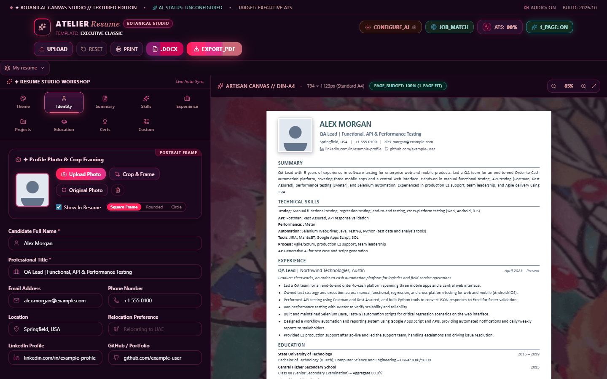
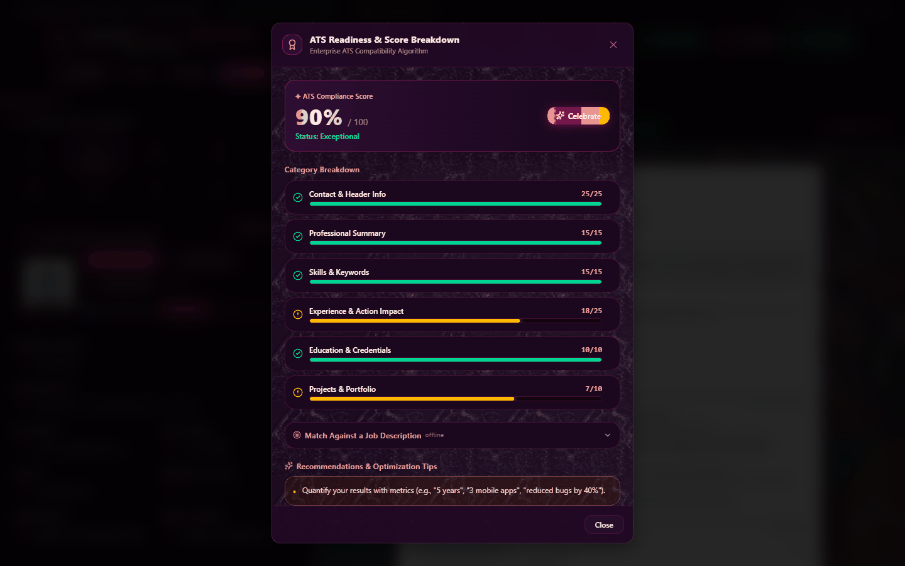
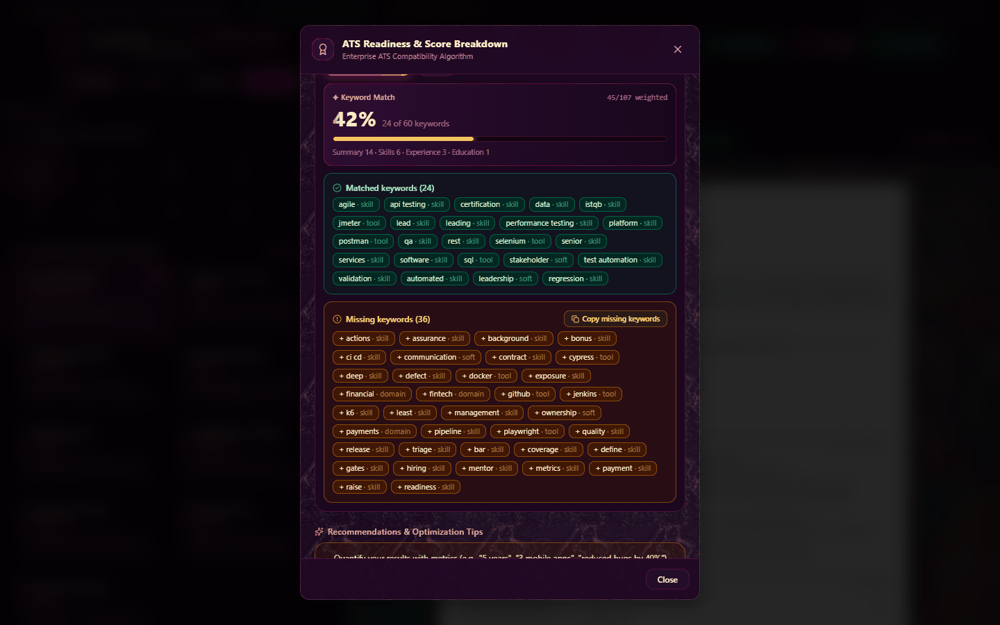
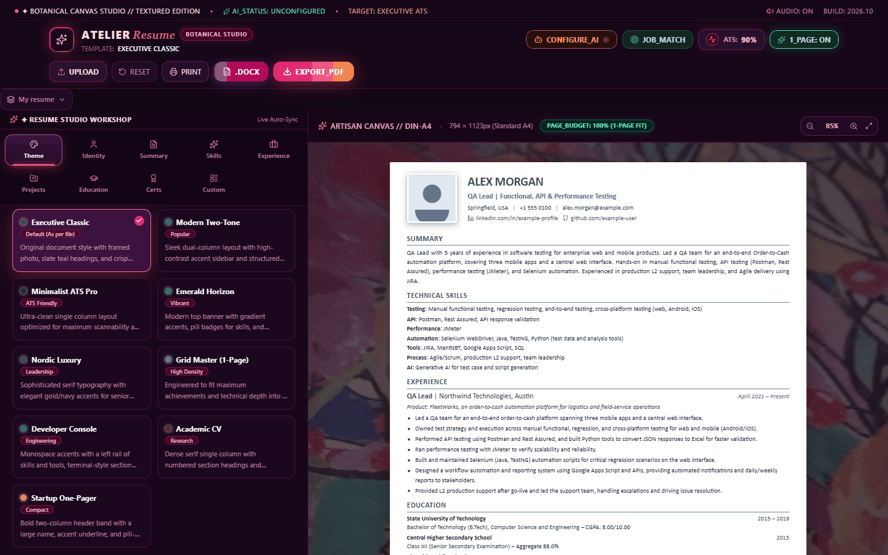

# Precision Resume Studio

A resume builder with a live ATS score, six templates, native DOCX/PDF export,
multi-provider AI writing assistance, and an optional Playwright agent that
scrapes job boards and pre-fills application forms.

Built with React 19, Vite 8 and Tailwind CSS 4.

> **Read [Legal & responsible use](#legal--responsible-use) before deploying the
> job-discovery agent.** It automates actions that job boards prohibit in their
> terms of service, and you are responsible for how you use it.

**v1.0** adds multiple resume variants, Projects and Custom Sections, and a full
accessibility pass. See [CHANGELOG.md](./CHANGELOG.md).

---

## Screenshots



| ATS breakdown | Job-description matcher |
|---|---|
|  |  |



To recapture yours: run `npm run dev`, open http://localhost:5173, press
`Win+Shift+S` (Windows) or `Cmd+Shift+4` (macOS), and replace the files in
`docs/`. Capture at 1440×900 at 1× scale — larger screenshots bloat the repo
without looking sharper on GitHub.

---

## Features

### Resume building

- **Multiple resume variants** — keep a named, job-targeted copy per application
  ("QA Lead - Dubai", "Automation Engineer"), switch between them instantly,
  duplicate one to tailor it, and export/import the whole set as JSON
- **Six templates** — Executive Classic, Modern Two-Tone, Minimalist ATS Pro,
  Emerald Horizon, Nordic Luxury, Grid Master (single-page dense)
- **Projects & custom sections** — showcase side projects, publications,
  volunteering or anything else; rendered by every template
- **Template capability warnings** — if switching templates would hide a section
  you filled in, the picker tells you before you switch
- **Native DOCX export** — real `.docx` with an embedded photo (aspect ratio
  preserved), coloured headings and proper bullet lists
- **PDF export and print** — captured at A4's true width so text stays sharp
- **Live ATS score** — weighted scoring across contact info, summary length,
  skill coverage, action verbs, quantified results, education and projects
- **Theme customiser** — colours, fonts, density, single-page auto-fit
- **Resume ingestion** — import a DOCX/JSON/TXT resume and auto-fill the form,
  using AI when configured and a rule-based parser otherwise
- **Photo crop tool** — zoom, rotate, pan, with square/rounded/circle frames

### Accessibility

Every dialog is keyboard-operable and announced correctly to screen readers:

- `role="dialog"` + `aria-modal` with a labelled heading
- Focus moves into the dialog on open and returns to the trigger on close
- Tab and Shift+Tab cycle inside the dialog; Escape closes it
- Background scroll locked while open
- Visible focus rings, `aria-label` on every icon-only control, `aria-pressed`
  on toggles

### AI assistance

Any OpenAI-compatible endpoint works. Built-in presets: Vyce AI, Groq, OpenAI,
OpenRouter, DeepSeek, Mistral, Ollama (local) and a custom endpoint. The app can
discover available models from the endpoint and test the connection.

- Polish a summary or a single bullet (Google XYZ formula)
- Suggest in-demand skills for a target role
- Score and tailor a resume against a pasted job description
- Generate a cover letter grounded only in facts from the resume

### Job discovery and apply agent (optional, local only)

> This part runs on your own machine, not on a static host. See
> [Running the agent](#running-the-jobs-agent-locally).

- Scrapes LinkedIn, Naukri and Indeed via Playwright, with per-site retry
- UAE/Gulf aware: regional Indeed hosts, normalised Gulf locations
- Expands narrow job titles to related discipline terms when matches are sparse
- Fills application forms across Greenhouse, Lever, Workday, Ashby,
  SmartRecruiters, Taleo, iCIMS, SuccessFactors, BambooHR, JazzHR and Personio
- **Never submits without a double confirmation in the UI**
- **Never answers protected-characteristic questions** (gender, ethnicity,
  veteran status, disability, religion, pronouns)
- **Never solves CAPTCHAs** — it reports them for you
- Reports which fields were filled, skipped, or need a human

---

## Quick start

Requires **Node.js 18+**.

```bash
git clone https://github.com/akshaytp1571/resume-builder.git
cd resume-builder
npm install
npm run dev            # http://localhost:5173
```

That is all you need to build and export resumes. The app is fully client-side:
your resume data lives in your browser's `localStorage` and never leaves your
machine except when you explicitly call an AI provider.

### Configure AI

Open **AI Settings** in the navbar and pick a provider. For a local model with
no key, choose Ollama and run `ollama serve`.

Alternatively, set a key at build time:

```bash
# .env.local
VITE_AI_API_KEY=your-key-here
```

> `VITE_*` variables are **inlined into the public JavaScript bundle**. Anyone
> who loads your deployed site can read them. Use the in-app settings modal for
> a public deployment and leave this empty.

Nothing is required to get started: without an AI key the builder works fully,
and AI buttons prompt you to configure a provider.

---

## Scripts

| Command | What it does |
|---|---|
| `npm run dev` | Vite dev server on :5173 |
| `npm run build` | Production build to `dist/` |
| `npm run build:static` | Build + add `404.html`, `_headers`, SHA-256 manifest |
| `npm run package:zip` | Package `dist/` into an uploadable ZIP |
| `npm run preview` | Serve the production build locally |
| `npm test` | 87 source checks over parsers, scorer, exporters, store and agent logic |
| `npm run test:smoke` | Import the real modules and assert runtime behaviour |
| `npm run test:all` | Both suites |
| `npm run lint` | oxlint |
| `npm run verify:deploy <url>` | Verify a deployed site is actually working |
| `npm run jobs:api` | Start the job agent API on :3457 |
| `npm run jobs:test` | Run the scrapers standalone against live sites |

---

## Running the jobs agent locally

The agent needs a **real Google Chrome install**. Playwright's bundled Chromium
gets blocked by Naukri and Indeed, so the engine launches the system Chrome via
`channel: 'chrome'` and falls back to bundled Chromium only if Chrome is absent.

```bash
npx playwright install chromium   # fallback browser
npm run jobs:api                  # terminal 1 — agent on :3457
npm run dev                       # terminal 2 — the app
```

Then in the app: **JOB_MATCH** → **Logins** (add credentials and the absolute
path to your exported DOCX) → **Auto-Discover** → **Search Job Postings**.

To apply: click **Apply** on a result, optionally generate a cover letter, then
**Prepare Application**. Review the report and screenshot, then press
**Submit Application** twice if you want the agent to click submit.

Job-board credentials are stored in `localStorage` and sent only to
`http://localhost:3457`. They are never transmitted to an AI provider.

---

## Deployment

The resume builder is a static site. `npm run build:static` produces a `dist/`
folder you can serve from any static host.

See **[DEPLOY.md](./DEPLOY.md)** for a complete walkthrough, including:

- building and packaging for upload
- cache headers and the 404 page
- domain and HTTPS setup
- post-deploy verification
- why the job agent should **not** be hosted alongside it

The agent requires a locally installed Chrome and holds job-board credentials,
so it belongs on a machine you control.

---

## Project layout

```
src/
├── agents/                  # Node-side agent harness (.cjs, CommonJS)
│   ├── api-server.cjs       # Express API: /api/discover-jobs, /api/apply, /health
│   ├── browser-scrapers/    # Playwright job-board scrapers
│   └── apply-agent/         # Application filler + candidate profile
├── components/
│   ├── editor/              # Resume form panels
│   ├── preview/             # Live preview + zoom + page-budget indicator
│   ├── templates/           # The six templates, PhotoFrame, ExtraSections
│   └── ui/                  # Modals, ModalShell, VariantSwitcher
├── data/
│   ├── initialData.js       # Placeholder resume + default theme
│   └── templateCapabilities.js  # Which sections each template renders
├── utils/
│   ├── resumeStore.js       # Resume variants + migration
│   └── ...                  # AI, ATS scoring, exporters, parsers, discovery
└── assets/                  # Placeholder avatar, hero art
scripts/                     # Build, packaging, verification, asset generation
```

The agent harness runs in Node, so those files use `.cjs`; the package itself is
ESM (`"type": "module"`).

---

## How the ATS score works

The score is a weighted sum, capped at 100:

| Category | Max | What it checks |
|---|---|---|
| Contact & header | 25 | Name, title, valid email, phone, location |
| Professional summary | 15 | Word count in a recruiter-friendly band |
| Skills & keywords | 15 | Category count, skill count, custom-section keywords |
| Experience & impact | 25 | Action verbs and quantified results |
| Education | 10 | Presence and completeness |
| Projects & portfolio | 10 | Presence, action verbs, quantified results |

Each category reports its own status so the UI can show what to fix.

---

## Legal & responsible use

**The resume builder is a normal web app.** The automated agent is different, and
you should understand what it does before using it.

The job-discovery and apply agents automate interactions with third-party sites.
**LinkedIn, Indeed, Naukri and most job boards prohibit automated access,
account login by bots, and automated form submission in their terms of service.**
They deploy bot detection specifically to prevent it.

Specifically, this code:

- launches a browser with anti-detection settings
  (`navigator.webdriver` spoofing, UA and locale overrides)
- types your job-board password into a login form
- fetches and parses job listings programmatically
- pre-fills and optionally submits employer application forms

**Using it may violate those platforms' terms and could lead to your account
being suspended or banned, at their sole discretion.** Depending on your
jurisdiction it may also breach their contract terms or data-protection rules.

This project is published for **educational and research purposes** — as a
worked example of browser automation, form classification and agent design. It
is not an endorsement of scraping or automated applying.

**You accept these risks if you run the agent.** The authors provide no
warranty and accept no liability for account bans, legal consequences, or any
damage arising from its use. See [LICENSE](./LICENSE).

If you want to use the underlying ideas responsibly, prefer official APIs:
[Greenhouse](https://developers.greenhouse.io/),
[Lever](https://github.com/lever/postings-api),
[Ashby](https://developers.ashbyhq.com/), and
[Workable](https://workable.readme.io/) all offer public job-board APIs, and
most ATS platforms accept applications through supported channels.

### Protecting your own data

- `.scraper-profile/` holds live browser cookies and is **gitignored** — never
  commit it
- Job-board credentials live in `localStorage` in plaintext; this is only
  appropriate on a machine you control
- The sample resume in `src/data/initialData.js` is entirely fictional

---

## Contributing

Issues and pull requests are welcome.

```bash
npm install
npm run test:all   # 87 source checks + runtime smoke test, all must pass
npm run lint       # must report 0 errors
```

### Adding a template

1. Create `src/components/templates/YourTemplate.jsx` using `PhotoFrame` for the
   photo and `ExtraSections` for projects and custom sections.
2. Add its entry to `TEMPLATES_CONFIG` in `src/data/initialData.js`.
3. Add its capability list to `TEMPLATE_CAPABILITIES` in
   `src/data/templateCapabilities.js` — the test suite fails if you skip this.
4. Register it in the `switch` in `src/components/preview/ResumePreview.jsx`.

The capability registry exists so a template can never silently hide a section a
user filled in. `npm test` enforces that every configured template is declared.

Please do not open issues asking for help evading bot detection on specific
sites. Keep contributions focused on the app, the templates, the exporters and
the agent's correctness and safety model.

---

## License

[MIT](./LICENSE) © 2026 Akshay Saseendran

The MIT license covers this source code. It does **not** grant permission to
access any third-party site in violation of that site's terms.
